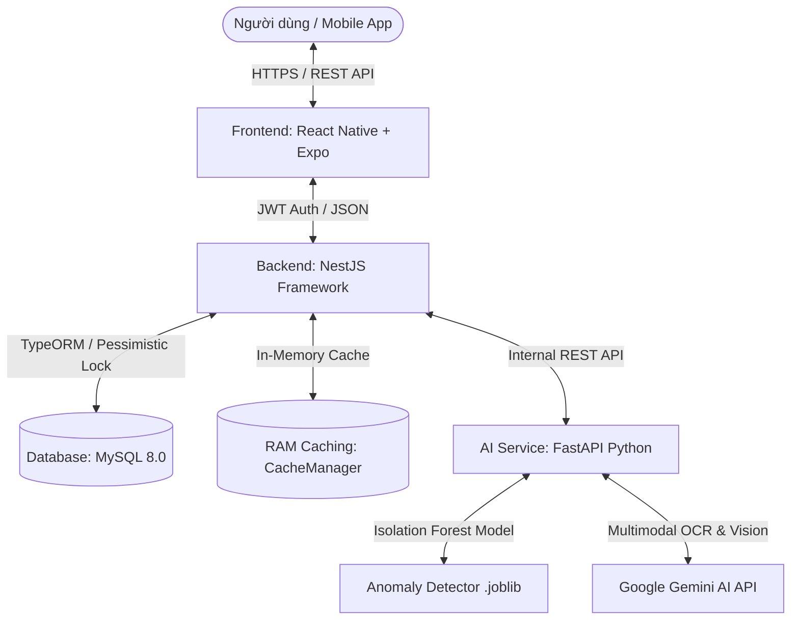

# 💸 SpendWise — Smart Personal Finance & AI Expense Tracker

> **SpendWise** là hệ thống quản lý tài chính cá nhân thông minh đa nền tảng, tích hợp công nghệ **Trí tuệ nhân tạo (Google Gemini)** và **Học máy (Machine Learning - Isolation Forest)** để tự động hóa quét hóa đơn, phân loại chi tiêu và cảnh báo rủi ro tài chính theo thời gian thực.

---

## 📌 Bảng mục lục
- [1. Kiến trúc hệ thống](#1-kiến-trúc-hệ-thống)
- [2. Tính năng nổi bật](#2-tính-năng-nổi-bật)
- [3. Công nghệ sử dụng](#3-công-nghệ-sử-dụng)
- [4. Cấu trúc thư mục](#4-cấu-trúc-thư-mục)
- [5. Hướng dẫn cài đặt & Chạy ứng dụng](#5-hướng-dẫn-cài-đặt--chạy-ứng-dụng)
  - [Bước 1: Chuẩn bị MySQL Database](#bước-1-chuẩn-bị-cơ-sở-dữ-liệu-mysql)
  - [Bước 2: Khởi động AI Service (Python FastAPI)](#bước-2-khởi-động-ai-service-python-fastapi)
  - [Bước 3: Khởi động Backend (NestJS)](#bước-3-khởi-động-backend-nestjs)
  - [Bước 4: Khởi động Frontend (React Native - Expo)](#bước-4-khởi-động-frontend-react-native---expo)
- [6. Danh sách API chính](#6-danh-sách-api-chính)
- [7. Huấn luyện lại mô hình AI (Retrain Model)](#7-huấn-luyện-lại-mô-hình-ai-retrain-model)
- [8. Hướng dẫn Build & Deploy](#8-hướng-dẫn-build--deploy)

---

## 1. Kiến trúc hệ thống

Hệ thống được thiết kế theo kiến trúc Microservices phân tầng tách biệt, bảo mật và hiệu năng cao:



---

## 2. Tính năng nổi bật

### 💳 1. Quản lý Đa Ví & Giao dịch an toàn
- Tạo và quản lý nhiều nguồn tiền: Ví tiền mặt, Tài khoản ngân hàng, Thẻ tín dụng, Ví điện tử...
- **Chuyển tiền giữa các ví**: Áp dụng cơ chế **Pessimistic Locking** (`pessimistic_write`) chống lỗi xung đột số dư (Lost Update / Race Condition).
- Tự động hoàn tác số dư ví khi xóa hoặc chỉnh sửa giao dịch.

### 🧾 2. Quét hóa đơn thông minh bằng AI (OCR & Auto-Categorization)
- Tự động nén ảnh hóa đơn ngay tại Client (giảm 85% dung lượng) trước khi tải lên.
- Sử dụng **Google Gemini Multimodal AI** trích xuất thông tin: Tên cửa hàng, tổng tiền, ngày giờ, danh sách từng món hàng kèm giá và số lượng.
- Tự động đối chiếu và gợi ý danh mục chi tiêu chính xác nhất cho người dùng.

### 🧠 3. Cảnh báo rủi ro chi tiêu theo thời gian thực (Machine Learning)
- Tích hợp mô hình học máy **Isolation Forest (150 cây quyết định)** phân tích đa chiều:
  - **Số tiền chi tiêu**: Đánh giá tỷ lệ vượt mức so với trung bình quá khứ của danh mục.
  - **Khung giờ giao dịch**: Phát hiện giao dịch bất thường phát sinh đêm khuya (23:00 – 05:00) nhằm cảnh báo nguy cơ lộ thẻ ngân hàng hoặc mua sắm mất kiểm soát.
  - **Điểm rủi ro (Risk Score)**: Phân loại cảnh báo `NORMAL`, `MEDIUM`, `HIGH` kèm lý do cụ thể và lời khuyên tài chính.
- Cơ chế **Fallback an toàn**: Nếu AI Service gián đoạn, Backend tự động kích hoạt bộ đánh giá Heuristic, đảm bảo app hoạt động thông suốt.

### 🎯 4. Ngân sách & Kế hoạch tài chính
- Đặt hạn mức chi tiêu theo từng danh mục trong tháng.
- Cảnh báo trực quan khi chi tiêu vượt hoặc sắp chạm ngưỡng ngân sách đã định.

### 📊 5. Thống kê, Báo cáo & Xuất Excel
- Biểu đồ phân bổ chi tiêu động theo Tuần / Tháng / Năm.
- Lọc chi tiết theo từng ví hoặc tổng hợp tất cả tài khoản.
- Xuất toàn bộ báo cáo thu chi ra file **Excel (`.xlsx`)** tiêu chuẩn chỉ với một chạm.

### ⚡ 6. Tối ưu hiệu năng & Trải nghiệm
- **In-Memory Caching (RAM)**: Cache danh mục và các thống kê summary nặng (TTL 5 phút), tự động xóa cache khi phát sinh giao dịch mới.
- **HTTP Compression**: Bật nén Gzip/Brotli giảm thiểu lưu lượng mạng truyền tải.
- **Smart Input UX**: Tự động định dạng số tiền dạng `3.000.000 đ` kèm thanh chip gợi ý nhanh giá trị (30.000, 300.000, 3.000.000...).

---

## 3. Công nghệ sử dụng

| Tầng | Công nghệ / Thư viện chính |
|---|---|
| **Mobile App (Frontend)** | React Native, Expo SDK, Expo Router, TypeScript, Zustand, SecureStore, Lucide/Ionicons |
| **Backend API** | NestJS, TypeORM, MySQL 8.0, JWT, Throttler Guard (Rate Limit), Cache-Manager, Compression, xlsx |
| **AI / Machine Learning** | Python 3.10+, FastAPI, Uvicorn, Scikit-learn (IsolationForest), Joblib, NumPy, Google Gemini API |
| **Bảo mật** | JWT Authentication, Quản lý phiên đăng nhập 1 thiết bị, Mã hóa mật khẩu bcrypt |

---

## 4. Cấu trúc thư mục

```text
Thực tập thực tế/
├── ai-module/                      # Dịch vụ Trí tuệ nhân tạo (Python FastAPI)
│   ├── app/
│   │   ├── ml/                     # Huấn luyện mô hình Isolation Forest
│   │   │   └── train_anomaly_model.py
│   │   ├── models/                 # Trọng số mô hình đã đóng gói (.joblib)
│   │   │   └── anomaly_detector.joblib
│   │   ├── routers/                # API Routers: ocr, classify, receipt, anomaly
│   │   ├── schemas/                # Pydantic Schemas request/response
│   │   ├── services/               # Gemini Service & Anomaly Service
│   │   └── main.py                 # Điểm khởi chạy FastAPI
│   └── requirements.txt            # Thư viện Python
│
├── backend/                        # Backend REST API (NestJS)
│   ├── src/
│   │   ├── modules/
│   │   │   ├── auth/               # Đăng ký, đăng nhập, phân quyền JWT
│   │   │   ├── users/              # Quản lý người dùng & phiên đăng nhập
│   │   │   ├── wallets/            # Quản lý ví & chuyển tiền
│   │   │   ├── categories/         # Danh mục thu chi & in-memory cache
│   │   │   ├── transactions/       # Giao dịch, thống kê summary, check-anomaly, xuất Excel
│   │   │   ├── budgets/            # Hạn mức ngân sách
│   │   │   ├── receipts/           # Quản lý hóa đơn & xác nhận tạo giao dịch
│   │   │   └── ai-integration/     # Cầu nối tích hợp an toàn với AI Module
│   │   ├── app.module.ts           # AppModule cấu hình TypeORM, CacheModule, Throttler
│   │   └── main.ts                 # Điểm chạy NestJS (bật Compression, CORS, Swagger)
│   ├── package.json
│   └── tsconfig.json
│
├── frontend/                       # Mobile App (React Native - Expo)
│   ├── assets/images/              # Logo SpendWise, icon, assets
│   ├── src/
│   │   ├── app/                    # Màn hình theo file-based routing Expo Router
│   │   │   ├── (auth)/             # Đăng nhập, đăng ký
│   │   │   └── (app)/              # Màn hình chính, (tabs), add-transaction
│   │   ├── features/               # API clients, hooks & components theo module
│   │   ├── components/             # UI components dùng chung (Input, Button, Modal...)
│   │   ├── utils/                  # Format tiền tệ, ngày tháng, gợi ý số tiền
│   │   └── theme/                  # Hệ thống bảng màu & typography chuẩn FinTech
│   ├── app.json
│   └── package.json
│
└── README.md                       # Tài liệu hướng dẫn toàn bộ dự án
```

---

## 5. Hướng dẫn cài đặt & Chạy ứng dụng

### Yêu cầu môi trường
- **Node.js**: Phiên bản 18.x trở lên
- **Python**: Phiên bản 3.10 trở lên
- **MySQL Server**: Phiên bản 8.0 trở lên
- **Expo Go App** (trên điện thoại Android/iOS) hoặc Trình giả lập (Emulator).

---

### Bước 1: Chuẩn bị cơ sở dữ liệu MySQL
1. Mở MySQL Workbench hoặc Terminal MySQL, tạo database mới:
   ```sql
   CREATE DATABASE spending_rationale CHARACTER SET utf8mb4 COLLATE utf8mb4_unicode_ci;
   ```
2. Kiểm tra file cấu hình môi trường tại `backend/.env`:
   ```env
   PORT=3000
   DB_HOST=localhost
   DB_PORT=3306
   DB_USERNAME=root
   DB_PASSWORD=your_password
   DB_DATABASE=spending_rationale
   JWT_SECRET=spendwise_super_secret_jwt_key
   AI_SERVICE_URL=http://localhost:8000
   ```

---

### Bước 2: Khởi động AI Service (Python FastAPI)
1. Mở Terminal và di chuyển vào thư mục `ai-module`:
   ```bash
   cd ai-module
   ```
2. Kích hoạt môi trường ảo:
   - **Windows PowerShell**:
     ```powershell
     .\venv\Scripts\activate
     ```
   - **macOS / Linux**:
     ```bash
     source venv/bin/activate
     ```
3. Cài đặt các thư viện phụ thuộc:
   ```bash
   pip install -r requirements.txt
   ```
4. Cấu hình file `ai-module/.env` (điền API Key Gemini của bạn):
   ```env
   GEMINI_API_KEY=your_google_gemini_api_key_here
   ```
5. Khởi động AI Service:
   ```bash
   uvicorn app.main:app --reload --port 8000
   ```
   > ✅ AI Service sẽ chạy tại: `http://localhost:8000` (Tài liệu API Swagger tại: `http://localhost:8000/docs`).

---

### Bước 3: Khởi động Backend (NestJS)
1. Mở một Terminal mới và di chuyển vào thư mục `backend`:
   ```bash
   cd backend
   ```
2. Cài đặt các gói npm:
   ```bash
   npm install
   ```
3. Khởi chạy ở chế độ phát triển (Development):
   ```bash
   npm run start:dev
   ```
   > ✅ Backend API sẽ chạy tại: `http://localhost:3000` (Tài liệu Swagger API tại: `http://localhost:3000/api`).

---

### Bước 4: Khởi động Frontend (React Native - Expo)
1. Mở một Terminal mới và di chuyển vào thư mục `frontend`:
   ```bash
   cd frontend
   ```
2. Cài đặt các gói npm:
   ```bash
   npm install
   ```
3. Kiểm tra file `frontend/.env` (đảm bảo trỏ đúng IP máy tính trong cùng mạng LAN hoặc dùng Tunnel):
   ```env
   EXPO_PUBLIC_API_URL=http://<IP_LAN_CUA_BAN>:3000
   ```
4. Chạy ứng dụng qua Tunnel:
   ```bash
   npx expo start --tunnel
   ```
5. Mở ứng dụng **Expo Go** trên điện thoại thực tế và quét mã QR hiển thị trên màn hình Terminal để trải nghiệm.

---

## 6. Danh sách API chính

| Nhóm | Method | Endpoint | Mô tả |
|---|---|---|---|
| **Auth** | `POST` | `/auth/register` | Đăng ký tài khoản mới |
| **Auth** | `POST` | `/auth/login` | Đăng nhập & cấp phát Access Token |
| **Auth** | `GET` | `/auth/me` | Lấy thông tin cá nhân hiện tại |
| **Auth** | `POST` | `/auth/logout` | Đăng xuất & hủy phiên đăng nhập |
| **Wallets** | `GET` | `/wallets` | Lấy danh sách ví tài khoản |
| **Wallets** | `POST` | `/wallets` | Tạo ví thanh toán mới |
| **Wallets** | `POST` | `/wallets/transfer` | Chuyển tiền giữa 2 ví (Pessimistic Lock) |
| **Categories** | `GET` | `/categories` | Lấy danh mục thu/chi (Có RAM Cache) |
| **Categories** | `POST` | `/categories` | Tạo danh mục chi tiêu tùy chỉnh |
| **Transactions** | `GET` | `/transactions` | Phân trang danh sách giao dịch (lọc loại, ví, từ khóa) |
| **Transactions** | `POST` | `/transactions` | Thêm giao dịch thu/chi mới |
| **Transactions** | `POST` | `/transactions/check-anomaly` | Gọi AI đánh giá mức độ bất thường & rủi ro |
| **Transactions** | `GET` | `/transactions/summary` | Thống kê thu chi theo tuần/tháng/năm |
| **Transactions** | `GET` | `/transactions/export/excel` | Xuất toàn bộ sao kê ra file Excel (.xlsx) |
| **Budgets** | `GET` | `/budgets/status` | Xem trạng thái ngân sách của tháng hiện tại |
| **Receipts** | `POST` | `/receipts/scan` | Tải ảnh hóa đơn lên để AI bóc tách OCR |
| **Receipts** | `POST` | `/receipts/:id/confirm` | Xác nhận hóa đơn để sinh giao dịch chính thức |

---

## 7. Huấn luyện lại mô hình AI (Retrain Model)

Khi muốn tái huấn luyện mô hình Machine Learning phát hiện bất thường với các siêu tham số hoặc dữ liệu mới:

```bash
cd ai-module
# Kích hoạt venv
python -m app.ml.train_anomaly_model
```
> Tập lệnh sẽ huấn luyện **150 cây quyết định** và tự động ghi đè trọng số mới vào `app/models/anomaly_detector.joblib`.

---

## 8. Hướng dẫn Build & Deploy

### Đóng gói ứng dụng Android (Tạo file APK)
Sử dụng **EAS Build** của Expo để xuất file `.apk` cài đặt trực tiếp lên điện thoại:
```bash
cd frontend
# Cài đặt công cụ EAS CLI
npm install -g eas-cli

# Đăng nhập tài khoản Expo
eas login

# Build file APK
eas build -p android --profile preview
```

### Triển khai Backend & AI lên VPS (Docker Compose)
Dự án có thể dễ dàng triển khai lên Ubuntu VPS (DigitalOcean / AWS / Linode) qua `docker-compose`:
1. Đóng gói dịch vụ Backend và AI Module thành Docker Image.
2. Cấu hình Nginx Reverse Proxy kèm chứng chỉ SSL miễn phí từ **Let's Encrypt**:
   ```bash
   sudo certbot --nginx -d api.spendwise.yourdomain.com
   ```
3. Cập nhật `EXPO_PUBLIC_API_URL=https://api.spendwise.yourdomain.com` trong app mobile.

---

<p align="center">
  <b>SpendWise</b> — Quản lý tài chính cá nhân thông minh & an toàn.
</p>